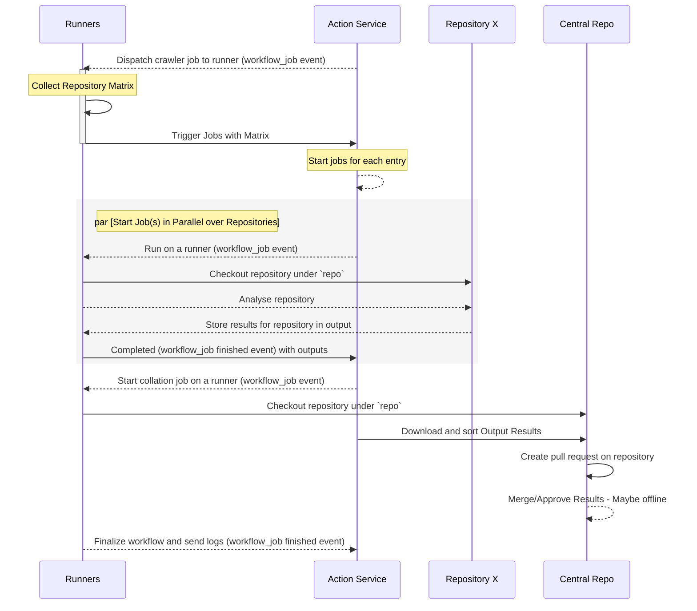

# The Configuration Centralization Pattern

In today's software development environment, especially in decentralized settings, efficiently cataloging and sharing solutions is a pressing concern. This becomes particularly noticeable when teams expand to a point where maintaining *consistent communication* becomes challenging. Moreover, the effort to distribute common libraries across diverse software divisions, each with its unique approach, adds to this complexity.

The **configuration centralization pattern** offers a solution. This method addresses these challenges by adeptly managing data from various repositories. Throughout this chapter, we'll explore the intricacies of this pattern, highlighting its potential to consolidate scattered data and boost its visibility.

A pivotal part of our discussion will be introducing a unified view hosted on **GitHub Pages**. This tool presents repository information in a clear and user-friendly manner, underscoring the significance of not just gathering data but also displaying it effectively.

By the chapter's conclusion, you'll have a thorough understanding of the configuration centralization pattern. Beyond theoretical knowledge, you'll acquire practical insights to incorporate this pattern into your projects, ensuring streamlined and centralized configuration management.

In this chapter, we are going to cover the following main topics:

* Understanding the configuration centralization pattern
* Creating a repository indexer
* Hosting the results using GitHub Pages

# Technical requirements

To follow along with the hands-on material in this chapter, you will need to follow the steps in the previous chapter or access the resources from that chapter and refer back to it if anything is ambiguous to you. We will continue to use our self-hosted runners to make these changes.

You'll need to add the topic of **public** on three to four public repositories in your organization. At the very least you need one, but to demonstrate a valuable output, having a couple would be useful. You can fork any repository on GitHub to your account if you do not have many.

You'll need to create a fork of the SAP *Innersource* portal at <https://github.com/SAP/project-portal-for-innersource> into your organization account. Rename the repository `My.GitHubOrg`.

You'll also need to create three GitHub Apps, which we have done previously. If you need a refresher, you can refer to the *Setting up a GitHub App* section in [*Chapter 11*](https://subscription.packtpub.com/book/cloud-networking/9781805128625/11). Create the three apps listed here:

1. The first one, named `innersource-scanner`, is to be permitted **read** access over the repository content. This will be the bot you use to scan the repositories. This must be installed on the org over all repositories or the ones you want to catalog.

2. The second will be a bot named `innersource-local` that will commit the source files to the repository when it is run on a schedule. This will need repo **read** and **write** access and the ability to write pull requests. This will *only* need to be installed in the **My.GitHubOrg** repository.

3. The third will be named `innersource-approver`, and it will approve the pull request process we're going to take with this pattern. This will need **read** and **write** access on the content and pull requests for the repository of **My.GitHubOrg**. We could have had it pushed to the main branch; alternatively, we could have also loosened the restrictions on the organization and allowed actions to write on this repository, eliminating the need for the `innersource-local` user.

After creating all of these, they will need to be installed in their various areas, and when doing so, you'll need to take note of their installation ID and app ID, as we'll need these later. You can save the **Privacy Enhanced Mail** (**PEM**) files as secrets on the repository of **My.GitHubOrg** as `BOT_SCANNER_PRIVATE_KEY`, `BOT_LOCAL_PRIVATE_KEY`, and `BOT_APPROVER_PRIVATE_KEY`, respectively.

We will be walking through the process of creating everything else in this chapter.

# Understanding the central configuration pattern

The central configuration pattern is a practical tool in the software development world, similar in some ways to the crawler pattern. But instead of making changes across multiple repositories, the central configuration pattern focuses on analyzing a single repository, pulling content, or storing computed data about that repository in the central repository.

This pattern is especially useful when creating a central data store is needed. It can be for gathering results or managing files from one central place. I've seen it used in three scenarios:

* One is when a central team wants to manage the **configuration files** of different repositories, ensuring they have the final approval over company master data.
* Another is when there's a need to collect data centrally to create visual displays using tools such as **Grafana** or even **custom** **web applications**.
* Internally accessible web portals enabling developers by exposing catalogs of API products and services created by other development teams. These are also known more commonly as **developer portals**.

In this chapter, we will dive deeper into the central configuration pattern, understanding its benefits and real-world applications. We'll also take a closer look at how to use it to build a custom web application and host it in GitHub, powered by data collected using GitHub actions of our organization through the calling of the GitHub API. This will be the basis of our developer portal, offering a cataloging process rendered by a portal.

First, let's look at how this pattern works. The central configuration pattern closely resembles the crawler pattern discussed in [*Chapter 12*](https://subscription.packtpub.com/book/cloud-networking/9781805128625/12). However, it pulls content or analytical data into central storage. This process is typically automated through scheduled workflows or initiated manually. It heavily depends on secrets stored in the repository to operate without user intervention.

> [!NOTE]
>
> While the pattern appears similar to the following diagram, the last three steps (*Create pull request on repository* and *Merge/Approve Results*) might vary based on the desired outcome or specific needs. We'll delve deeper into these variations later in this section.

Let's look at the general form of this pattern:



**Figure 13.1 – Flow for the central configuration pattern**

Once the data is within the repository, you can use the GitHub environment to do things such as deploy to environments, run validation routines, and update test environments on branches for users to validate. Each step is just another workflow running, all working together to meet a requirement.

This sort of pattern can be used by a GitHub App. There are some solutions, such as the Veracode GitHub App, that use a special repository in an organization to host and run their workflows for all subscribed repositories to that app. By hosting their workflows within your organization, you'll have the flexibility to run their scans on your infrastructure, making unique builds using privately accessed resources much easier to execute.

In other examples, I have used it to run a custom-built command-line tool over content in a commit during a pull request to validate it before it's merged into the main branch for use.

In this chapter, we will focus on building this portal, allowing you to explore use cases yourself once you've seen this technique in action. A lot of these use cases may be specific to your organization; understanding the pattern is the end goal here. Let's now work further with our forked **My.GitHubOrg** repository to collect information to power this implementation.

# Creating a repository indexer

Currently, to utilize **GitHub Pages** on our current free plan, a repository must remain publicly visible unless you have an enterprise account, which we don't. However, I'd advise against making it public for your specific needs unless you also intend to use Pages. Currently, GitHub doesn't offer a feature on the free plan for private pages that's easily accessible and simple to maintain compared to conventional web hosting. Yet, the solution to achieve our objective isn't overly complicated. Let's explore how to create a crawler that indexes repositories and evaluates their content:

1. Our first step is to design a workflow for the indexer to do this. Design a workflow that does the following:
   * Runs on a set schedule
   * Can be manually triggered
2. The workflow will collect data from all other repositories using the crawler pattern.
3. Utilize the GitHub API to fetch repository information.
4. Checkout the target repository to do the following:
   * Verify its content
   * Ensure it has the correct information
5. Add the verified data to the output of the job.
6. Allow the parent job to use the output in its master data aggregation.
7. The master data file is merged via a pull request to the main branch.

We know how to do a lot of this already; except for schedules and the analysis job, most of this was covered in the foundational section of this book in [*Chapter 2*](https://subscription.packtpub.com/book/cloud-networking/9781805128625/2). However, we haven't covered schedules, so let's quickly explore GitHub schedules before using them.

## Schedules in GitHub workflows

Using schedules in GitHub workflows allows you to run workflows automatically at specified intervals. GitHub uses the POSIX cron syntax to define schedule intervals. The format is as follows:

```sh
* * * * *
- - - - -
| | | | |
| | | | +---- Day of the week (0 - 6) [Sunday = 0]
| | | +------ Month (1 - 12)
| | +-------- Day of the month (1 - 31)
| +---------- Hour (0 - 23)
+------------ Minute (0 - 59)
```

There are some things to know about GitHub schedules. Let's take a look at the key constraints or important pieces of information you should know:

* **Time zone**: Scheduled workflows run in the UTC time zone.
* **Frequency limitations**: A workflow can be scheduled to run at most once every 5 minutes.
* **Missed scheduled workflows**: If a scheduled workflow is prevented from running (e.g., due to a GitHub outage), GitHub will not queue it to run later. It'll simply be missed.
* **Activity-based restrictions**: If a repository doesn't have any activity (e.g., no commits or PRs) for 60 days, scheduled workflows can be suspended. To resume, you'll need to push a commit or take some other repository activity.

Defining schedules in GitHub workflows is done in a similar manner to subscribing to pull requests, or pushes. Using the `on` parameter in the workflow, you then have to use a format like the following:

```yml
on:
  schedule:
    - cron: '30 2 * * *'  # Runs every day at 2:30 AM UTC
```

The schedule takes in an array, so you can specify multiple crons. This can be done as follows:

```yml
on:
  schedule:
    - cron: '30 2 * * *'  # Every day at 2:30 AM UTC
    - cron: '45 14 * * 5' # Every Friday at 2:45 PM UTC
```

Designing a cron is easy if you use resources such as <https://crontab.guru/>.

Now we know about schedules, let's set up our workflow to run on a schedule and index the repositories.

## Setting up the indexer

In this section, we're going to set up the workflow in the repository to collect on a timer all the repositories that have a topic on them and scan and report on them.

Follow these steps in the **My.GitHubOrg** repository to create the indexer:

1. Add a new workflow called `scheduled.collect-repos.nightly.yaml` to the repository.
2. The workflow is to run on a schedule of nightly at 1 am, which will look like `0 1 * * *`. Your event subscription should look like the following:

   ```yml
   name: InnerSource repo crawler - "JediSchools"
   on:
     workflow_dispatch:
     schedule:
       - cron: "0 1 * * *"
   ```

3. Now we want to set up the environment variables holding our organization name and the additional information we collected in the repository so it looks similar to the following:

   ```yml
   env:
     ORGANIZATION: "JediSchools"
     SCANNER_APP_ID: 123456
     SCANNER_INSTALLATION_ID: 123456789
     LOCAL_APP_ID: 654321
     LOCAL_INSTALLATION_ID: 987654321
     APPROVAL_APP_ID: 123654
     APPROVAL_INSTALLATION_ID: 654987321
   ```

4. Now we'll create the start of our job; as this is running on public repositories, we won't use the scale set names of our self-hosted runners. It will look like this:

   ```yml
   jobs:
     build:
       name: InnerSource repo crawler
       runs-on: [ ubuntu-latest ]
   ```

5. We now want to collect a token for each of the GitHub Apps we've created. This will be a little repetitive as we use the same action for the next couple of steps. The following code snippet is for the bot scanner:

   ```yml
       - name: Generate Scanner GitHub App Token
         id: generate_token_scanner
         uses: tibdex/github-app-token@v1
         with:
           app_id: ${{ env.SCANNER_APP_ID }}
           private_key: ${{ secrets.BOT_SCANNER_PRIVATE_KEY }}
           installation_id: ${{ env.SCANNER_INSTALLATION_ID }}
   ```

6. The following steps are for the Apps we installed only against the **My.GitHubOrg** repository:

   ```yml
       - name: Generate Local GitHub App Token
         id: generate_token_local
         uses: tibdex/github-app-token@v1
         with:
           app_id: ${{ env.LOCAL_APP_ID }}
           private_key: ${{ secrets.BOT_LOCAL_PRIVATE_KEY }}
           installation_id: ${{ env.LOCAL_INSTALLATION_ID }}
       - name: Generate Approval GitHub App Token
         id: generate_token_approver
         uses: tibdex/github-app-token@v1
         with:
           app_id: ${{ env.APPROVAL_APP_ID }}
           private_key: ${{ secrets.BOT_APPROVER_PRIVATE_KEY }}
           installation_id: ${{ env.APPROVAL_INSTALLATION_ID }}
   ```

7. Next, we want to checkout our local repository, as we will save the results of our subsequent scan in the repository:

   ```yml
       - name: Checkout code
         uses: actions/checkout@v3
   ```

8. Now, we'll run the indexer, which will call out to our organization API, download the results of the API, and query for all repositories using a topic:

   ```yml
       - name: Run crawler tool
         uses: docker://ghcr.io/zkoppert/innersource-crawler:v1
         env:
           GH_TOKEN: ${{ steps.generate_token_scanner.outputs.token }}
           ORGANIZATION: ${{ env.ORGANIZATION }}
           TOPIC: public
   ```

   This is set up to look for the topic of `public` that we added to a handful of repositories in the *Technical requirements* section, and it uses the scanner GitHub App token to query the API. When you run the image, it will produce a local `repos.json` file, which we'll now upload to the main branch of the repository.
9. Now, we will set up the next steps, which will be to raise a pull request. I will use the `peter-evans/create-pull-request` action and pipe the key details from the outcome of that action to the console for any troubleshooting we might run into. We'll use the local scanner token for this action:

   ```yml
       - name: Create Pull Request
         id: cpr
         uses: peter-evans/create-pull-request@v5
         with:
           token: ${{ steps.generate_token_local.outputs.token }}
           commit-message: "chore(meta): Upsert repos.json"
           title: '[Chore] Onboard repos datasource'
           body: This is an automated PR to update the data source required for inner source portal
           branch: onboard-innersource
           labels: automation
           delete-branch: true
   ```

   This creates the pull request and writes the details out to the console as follows:

   ```yml
       - name: Status
         run: |
           echo "Pull Request Number - ${{ steps.cpr.outputs.pull-request-number }}"
           echo "Pull Request URL - ${{ steps.cpr.outputs.pull-request-url }}"
           echo "Pull Request Operation - ${{ steps.cpr.outputs.pull-request-operation }}"
           echo "Pull Request Head SHA - ${{ steps.cpr.outputs.pull-request-head-sha }}"
   ```

10. We next need to approve the pull request and merge the pull request against the portal repository's default branch. We'll use the token of the approval bot to do this, and two actions, both from `juliangruber`:
    * First, we approve the pull request using `approve-pull-request-action` as follows:

      ```yml
          - name: Approve Pull Request
            uses: juliangruber/approve-pull-request-action@v1.1.1
            with:
              github-token: ${{ steps.generate_token_approver.outputs.token }}
              number: ${{ steps.cpr.outputs.pull-request-number }}
      ```
    
	* Next, we use `merge-pull-request-action` to merge the pull request using the `squash` method:

      ```yml
          - name: Merge Pull Request
            uses: juliangruber/merge-pull-request-action@v1
            with:
              github-token: ${{ steps.generate_token_approver.outputs.token }}
              number: ${{ steps.cpr.outputs.pull-request-number }}
              method: squash
      ```

11. Finally, I would like to upload the artifact, for debugging purposes. I find this is useful for the first couple runs of this workflow; eventually, I will remove this to save storage space:

    ```yml
        - uses: actions/upload-artifact@v3
          if: always()
          with:
            name: repo-artifact
            path: ./repos.json
            if-no-files-found: error
    ```

12. When we commit this and run it on the main branch, we should get a pull request raised, approved, and merged without any intervention. You only need to tag repositories for them to become indexed on the next run.

The file we created in this section can be found in `Chapter 13``/My.GitHubOrg/.github/workflows/scheduled.collect-repos.nightly.yaml`. One thing to note is that there is an opportunity that we didn't explore here, which was the option to mutate the `repos.json` file in the steps. This would allow you to add custom fields to the payload, which you can compute from information about the collected repository. An example that comes to mind is that perhaps you want to capture whether it has a `readme` or branch protections so you can provide the information to the central repository. Although we did not get to explore doing this, I have done so with the preceding workflow file so you get a general idea as to how it could be done.

In this section, we collected information from the various repositories and committed them locally to a central repository. This isn't a demonstration of pulling files from downstream into the central, but using the techniques you've learned so far, you could extend this out to do that if needed. In the next section, we'll look into hosting repository analysis results using GitHub Actions to build GitHub pages.

# Hosting the results using GitHub Pages

In this section, we'll build a workflow to host a GitHub page to demonstrate our collected data. At its core, GitHub Pages is a hosting service provided by GitHub that allows users to publish web content directly from their repositories. It's designed to host static websites, meaning it can serve HTML, CSS, and JavaScript files, but it doesn't support server-side code such as PHP or Python. This makes it an ideal choice for personal, project, or documentation websites.

GitHub Pages offers two primary methods for deploying your website:

* **Classic deployment**: This traditional approach involves pushing your static files to a specific branch in your repository. GitHub Pages automatically detects these files and publishes them as a website. It's straightforward and requires minimal setup, making it a favorite among users who prefer simplicity.

* **Actions deployment**: The newer method leverages GitHub Actions, which enables you to build, test, and deploy your code right from GitHub. With Actions, you can set up workflows that automatically build your website from source files whenever you push changes to your repository. This method offers more flexibility and control, allowing you to integrate various build processes and dependencies.

Selecting between classic deployment and Actions deployment hinges on the specific requirements of your project. Should you desire a swift and straightforward approach to launching your website, opting for the classic method could be your best bet. On the other hand, if your project necessitates a more intricate build process or you're inclined to streamline your deployment workflow, GitHub Actions provides the necessary tools and versatility.

This far into the book, you have the skills to build and deploy the static assets we want to upload, so we won't focus on it for this step but instead show you the GitHub actions that facilitate the deployment of pages.

## Configuring the repository for GitHub Pages

Before we get started with using the actions, we need to enable GitHub Pages on our repository. We'll also need to configure our repository to show our page on the front. To do this, follow these steps:

1. Navigate to the **Settings** page on the **My.GitHubOrg** repository.
2. Navigate to **Code and automation** | **Pages** as shown in the following screenshot:

   <br>
   **Figure 13.2 – Pages**

3. When you open the page, you'll see a page similar to the following. Click the **Deploy from a branch** dropdown and change it to **GitHub Actions**:

   <br>
   **Image 13.3 – GitHub Pages overview page**

4. That's all for this page; now you can head back to the **Repository overview** page and click the cog that can be found on the top right-hand panel to bring up the repository overview configuration screen. Click the **Use your GitHub Pages website** option and then save the changes:

   <br>
   **Image 13.4 – Enable this to use your GitHub Pages website from the repository**

That is all we needed to configure on the repository; the next step is to create the action to do the deployment.

## Creating the action for the deployment

For this, we will build a simple workflow that runs on a push to the main branch. It's going to checkout the repository, and then it's going to package the repository up and upload it to the Pages API. From there, we'll run another action to deploy the package.

To achieve this, follow these steps:

1. Create a workflow file named `build.deploy-pages.yaml` in the `workflows` directory.
2. Add a subscription to the `main` branch:

   ```yml
   name: Deploy Pages
   on:
     push:
       branches: [ "main" ]
   ```

3. Have it run a `pages-deploy` job on a public Ubuntu image and provide it with permissions to read `contents`, as well as to write `id-token` and `pages`:

   ```yml
   jobs:
     pages-deploy:
       runs-on: [ ubuntu-latest ]
       permissions:
         pages: write
         id-token: write
         contents: read
   ```

4. Next, we checkout the current repository to get the content we are going to upload:

   ```yml
       steps:
         - uses: actions/checkout@v3
   ```

5. We then use the following to upload the content, making it ready for publishing:

   ```yml
         - name: Publish Site
           uses: actions/upload-pages-artifact@v2
           with:
             path: ./
   ```

6. We can then trigger the deployment of the site to GitHub:

   ```yml
         - name: Deploy to GitHub Pages
           uses: actions/deploy-pages@v2
   ```

7. Now, if you access the link on the overview page after this action has run, you'll see something like the following:

   <br>
   **Image 13.5 – Our portal uploaded by our actions**

The code for this workflow can be found in `Chapter 13``/My.GitHubOrg/.github/workflows/build.deploy-pages.yaml`.

This concludes our chapter. While it may be shorter compared to others, the pattern discussed here is widely applicable and is a versatile solution for numerous specialized challenges. This approach presents ample opportunities to centralize configuration data and implement final-stage validations. By leveraging tools and scripts, you can ensure that your content adheres to structural and governance standards.

## Where to go next

In the upcoming chapters, we will further develop this concept, transforming it into a comprehensive hub for all our services, standardized workflows, and repositories. Should we opt for a paid subscription, it would be possible to host this internally, showcasing all the repositories. This approach aligns with what I described in the *Understanding the central configuration* *pattern* section.

# Summary

This chapter explored the configuration centralization pattern, a sophisticated strategy for managing and organizing configuration data across numerous repositories. It ensures uniformity and accessibility. Initially, the chapter shed light on the core principles of this pattern, highlighting its crucial role in fostering an efficient configuration management system.

We then transitioned from theory to practice, constructing a repository indexer workflow. Utilizing an existing action, we performed the initial indexing, meticulously gathering and organizing information from a variety of repositories. This crucial step showcased the pattern's ability to centralize data effectively. We also noted the potential to expand this process, using a matrix to aggregate data from each repository if needed.

As we approached the chapter's conclusion, our attention shifted to the integration and deployment facets of the pattern. The repository indexer's compiled data was committed to our portal repository through a workflow supported by a suite of GitHub Apps. These Apps were instrumental in facilitating a seamless and error-free integration into the main branch.

Our journey culminated in the deployment of the compiled results and the portal to GitHub Pages, once again harnessing the capabilities of GitHub Actions. This comprehensive demonstration not only highlighted the pattern's efficiency in centralizing configuration data but also its ability to simplify and enhance software development workflows. Looking ahead, the next chapter will delve into the utilization of events to initiate repositories. We will explore how repository events can be leveraged to create a self-service process, further streamlining and automating our development practices.

